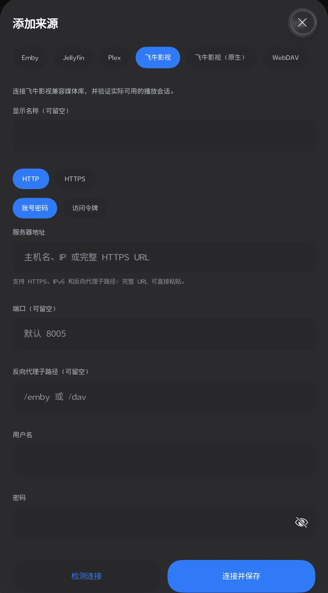
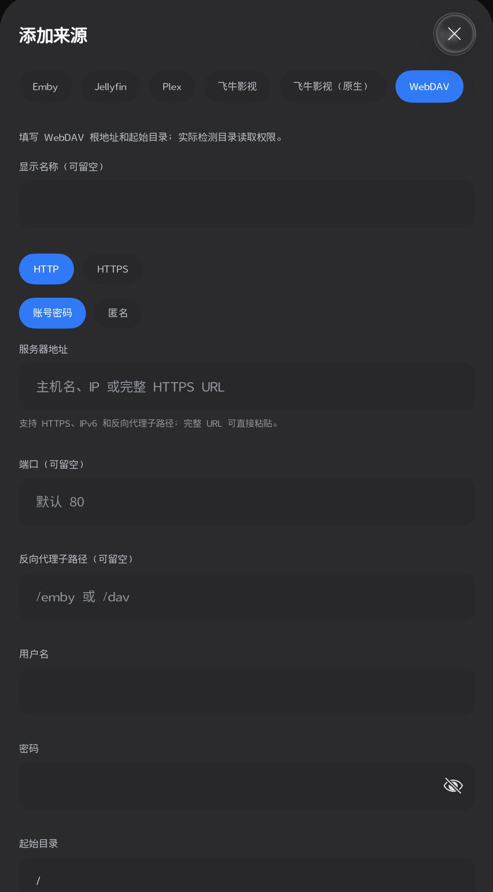
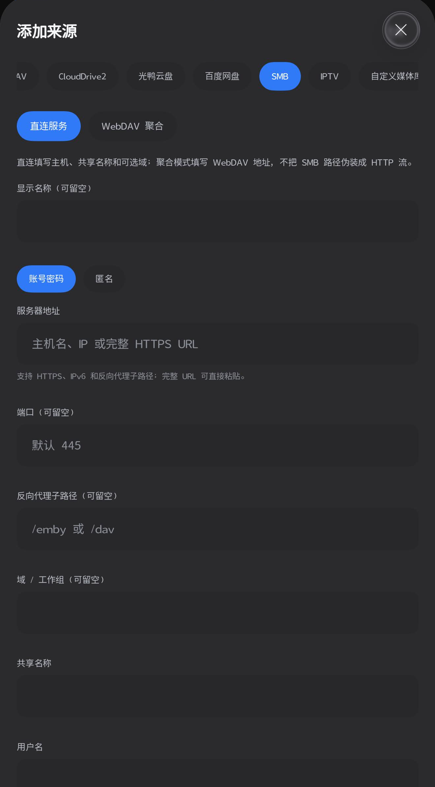
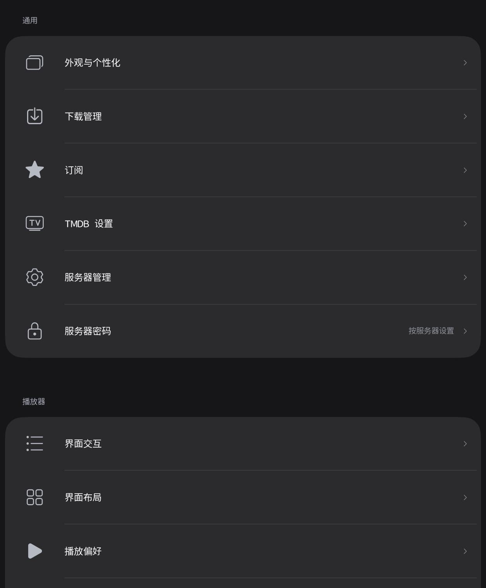

# VablePlayer for HarmonyOS

A native ArkTS / ArkUI / C++ client for browsing and playing your own media on HarmonyOS phones and tablets.

[中文说明](README.md) · [Build guide](docs/BUILDING.md) · [Features and limitations](docs/FEATURES.md) · [Architecture](docs/ARCHITECTURE.md) · [Contributing](CONTRIBUTING.md)

This is the first public source snapshot, prepared from the r38 development tree. There is no stable release from this repository yet. Provider adapters and menu entries describe implemented code, not universal compatibility. This HarmonyOS project does not build an Android APK.

## Screenshots

These are historical captures of this application, cropped only for privacy. They were not captured during this publication task and do not certify every provider.

| Source selection | WebDAV form |
| --- | --- |
|  |  |
| **SMB form** | **Settings** |
|  |  |

## Features

- Media-library browsing, posters, search, details, seasons, episodes, artwork and favorites where supported by the provider.
- Streaming through MPV or system AVPlayer paths, seeking, playback speed, aspect controls, audio/subtitle selection and end-of-episode continuation. Read and cache budgets remain bounded.
- Vision watching, watch-later and playlists scoped to the selected server and account.
- OpenAI-compatible subtitle services with user-supplied base URL, model and API key. Existing text subtitles are preferred; supported media can use bounded audio-window transcription when usable text subtitles are absent.
- Faithful cue-aligned translation: preserve order, timing and original meaning rather than asking the model to summarize or rewrite dialogue. Accuracy still depends on the source, model and service.
- A V-themed launch, artwork-derived ambient colors, pull gestures, glass materials and centrally managed motion.
- Per-server PIN protection and system-backed storage for server secrets and AI keys.

The source model has 13 provider kinds: Emby, Jellyfin, Plex, FnOS, FnOS native playback, WebDAV, CloudDrive2, Guangya, Baidu Netdisk, SMB, IPTV, custom JSON and local folders. Cloud authorization requires your own application credentials and user consent. Selected providers expose an explicit WebDAV aggregation mode. See the [provider matrix](docs/FEATURES.md) for prerequisites and boundaries.

The app does not include media, cloud accounts, IPTV subscriptions or AI-service credit. Picture-in-picture, casting, native extraction and some authorization flows require additional device and service validation.

## Build

Use a compatible DevEco Studio installation with the HarmonyOS API 26 SDK and Python 3. Node.js and TypeScript are needed for the source-level contract tests.

```sh
git clone https://github.com/MrLvable/VablePlayer-HarmonyOS.git
cd VablePlayer-HarmonyOS
python3 scripts/bootstrap_deps.py
ohpm install
```

Open the project in DevEco Studio and use your own signing configuration. On Windows, `python` may be the appropriate executable. Read [BUILDING](docs/BUILDING.md) for the complete workflow.

Only the unsigned `build-profile.example.json5` template is tracked. The bootstrap script creates the ignored local `build-profile.json5` on first use. SDK paths, signing files, credentials, caches, runtime data, HAR files, native binaries and install packages are excluded. Third-party binaries are restored from pinned upstream sources with hash checks; notices and source/build provenance are retained in [vendor](vendor/THIRD_PARTY_NOTICES.md).

A fresh installation offers built-in demonstration content. Add your own source for real playback and enter credentials inside the app.

## Validation and contributions

The tree contains 51 `tests/validate-*.cjs` contract scripts plus native helper/wrapper checks. Run `npm ci`, restore the OHPM dependency declarations as described in the build guide, then run `npm test`. Tests use actual source methods with controlled platform, network, storage or native mocks. They do not connect to a personal NAS and do not prove on-device decoding or universal provider support. See [test instructions](tests/README.md) and the [current validation record](docs/VALIDATION.md).

We welcome reproducible bug reports, provider compatibility fixes, original-media fixtures, tablet and accessibility improvements, subtitle timing tests, documentation and build tooling. Read [CONTRIBUTING](CONTRIBUTING.md), then open an [issue](https://github.com/MrLvable/VablePlayer-HarmonyOS/issues) or pull request. Never post personal endpoints, credentials or unreviewed logs/screenshots. Use [SECURITY](SECURITY.md) for sensitive reports.

## License

Project-owned code is licensed under [Apache-2.0](LICENSE). Third-party components retain their own licenses, including those covering the MPV wrapper, MPV, FFmpeg and libsmb2. The repository does not distribute precompiled HAR/native libraries or signed application packages. Review the [third-party notices](vendor/THIRD_PARTY_NOTICES.md) before using dependencies or distributing your own build.
