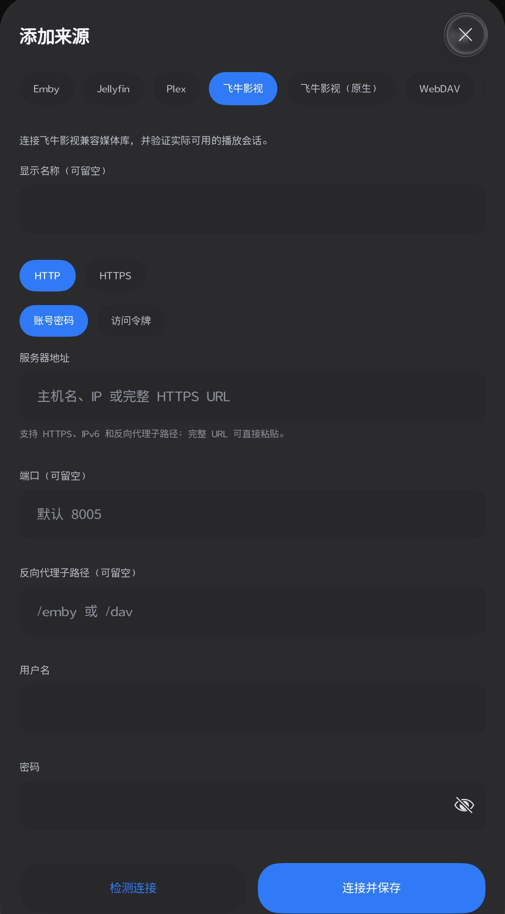
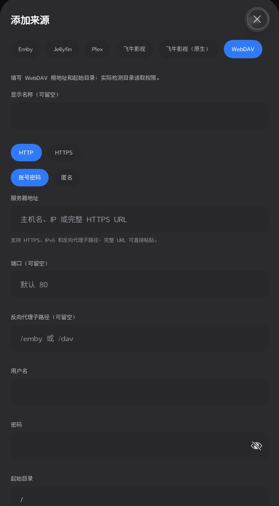
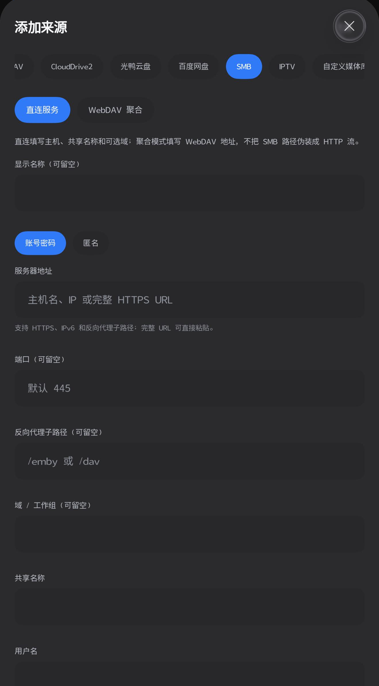
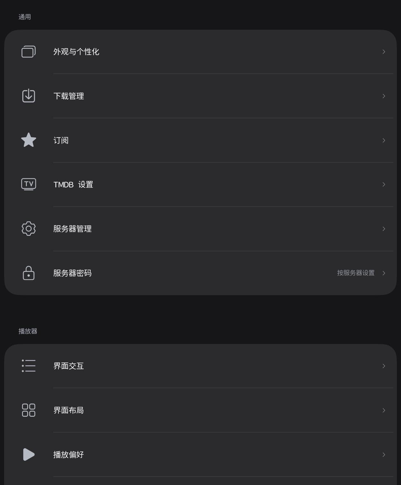

<p align="center">
  
</p>

# VablePlayer · HarmonyOS

把自己的媒体库带到鸿蒙设备上。

VablePlayer 是面向 **HarmonyOS 手机和平板**的原生媒体客户端，使用 ArkTS、ArkUI 和 C++ 开发。它将媒体库浏览、串流播放、观看管理与逐句 AI 字幕放在同一个应用中。欢迎一起完善协议适配、界面体验和真实设备兼容性。

[English](README.en.md) · [构建指南](docs/BUILDING.md) · [功能与来源边界](docs/FEATURES.md) · [架构](docs/ARCHITECTURE.md) · [参与贡献](CONTRIBUTING.md)

> 本仓库是从 r38 开发快照整理的首次开源源码，尚无本仓库的稳定发行版。菜单中存在某类来源，表示已有对应实现；不表示所有服务版本、设备和媒体均已验证。这里是鸿蒙工程，不能直接构建为 Android APK。

## 界面预览

以下为本项目历史真实界面截图，仅作隐私裁剪；并非本次新拍，不代表所有来源均已验收。

| 来源类型 | WebDAV 配置 |
| --- | --- |
|  |  |
| **SMB 配置** | **设置** |
|  |  |

## 可以做什么

- **浏览自己的影库**：首页海报、分类、搜索、详情、分季分集、相册和收藏；有服务器元数据时展示相应信息。
- **边播边看**：通过 MPV 或系统 AVPlayer 路径播放，提供进度定位、播放速度、画面比例、音轨、字幕和片尾接播逻辑。网络读取和缓存有明确预算，失败不会悄悄退回整片预下载。
- **管理观看计划**：Vision 提供在看、待看和播放列表。条目按服务器及账号范围隔离；进入当前来源时展示对应列表，避免串入另一个账号的记录。
- **配置一次使用 AI 字幕**：支持 OpenAI 兼容服务的 `base_url`、模型和用户自己的 API Key。优先处理已有文本字幕；没有可用文本字幕时，可对受支持的媒体提取有界音频窗口进行转写，再翻译到目标语言。
- **保留原话**：字幕翻译保留 cue 对应关系、顺序和时间轴，要求忠实逐句翻译，不主动总结、润色或补写对白。实际识别和翻译质量仍由媒体、模型及服务能力决定。
- **统一鸿蒙视觉**：V 主题启动、海报取色背景、下拉 Hero 变换、玻璃材质，以及统一管理的页面、菜单和交互动效。
- **按服务器加锁**：PIN 用于指定服务器的访问保护；服务器凭据与 AI 密钥通过系统安全存储处理。

小窗、投播、云盘授权及部分原生提取路径也有实现，验收范围见[功能说明](docs/FEATURES.md)。应用不提供影片、网盘账号、直播订阅或 AI 服务额度。

## 来源支持

当前配置模型包含 **13 类来源**。它们通过独立适配器连接各自协议，文件来源不会被包装成不存在的远端媒体库功能。

| 来源 | 已有实现 | 使用条件与边界 |
| --- | --- | --- |
| Emby / Jellyfin | 账号或令牌认证、媒体库、详情、播放协商、字幕、收藏与进度 | 反代路径、服务版本和媒体权限需在实际服务验证 |
| 飞牛影视 / 飞牛影视（原生） | 兼容目录，以及分别处理的 Range 或原生播放会话 | 目录令牌与原生会话分开；原生模式需有效原生登录凭据 |
| Plex | 令牌连接、媒体库、详情、播放及进度接口 | 需自己的服务令牌；不承诺所有转码组合 |
| WebDAV | 目录、文件浏览和播放 | 需对应目录读取权限；不假设存在影视元数据 |
| SMB | 只读目录与有界偏移读取、播放 Range 桥 | 需共享权限及原生依赖；弱网与设备兼容性待持续验证 |
| CloudDrive2 | 直连 gRPC-Web 文件接口；可显式选择 WebDAV 聚合 | 直连需要有效服务令牌；聚合需另行启用 WebDAV |
| 百度网盘 | 官方开放平台文件与授权流程；可显式聚合 | 需要自己的开发者应用与用户授权，受开放平台权限限制 |
| 光鸭云盘 | 官方开放平台文件接口与授权入口；可显式聚合 | 需要 Client ID 和用户令牌；设备授权需自有授权代理 |
| IPTV | M3U 分组、播放及可选 XMLTV 节目单 | 只读取用户提供的合法来源，不内置直播地址 |
| 自定义媒体库 | JSON 媒体清单与文件播放；可显式聚合 | 清单格式与权限由用户提供 |
| 本地文件夹 | 系统 Picker 授权、目录浏览与只读 fd 播放路径 | 不申请任意目录访问，授权能力取决于系统和设备 |

表内合并了两个影视服务分组，完整 13 个类型及连接条件见 [FEATURES](docs/FEATURES.md)。聚合模式是明确选择的 WebDAV 接入方式，直连失败会报告错误。

## 从源码开始

需要适配当前工程的 DevEco Studio / HarmonyOS API 26 SDK，以及 Python 3；本地契约测试还需要 Node.js 和 TypeScript。

```sh
git clone https://github.com/MrLvable/VablePlayer-HarmonyOS.git
cd VablePlayer-HarmonyOS
python3 scripts/bootstrap_deps.py
ohpm install
```

Windows 可将 `python3` 换为本机的 `python`。随后在 DevEco Studio 打开工程，使用自己的设备、华为账号与签名配置进行编译安装。完整步骤见[构建指南](docs/BUILDING.md)。

仓库只跟踪无签名的 `build-profile.example.json5`。依赖恢复脚本首次生成本机 `build-profile.json5`，实际配置及签名文件被 Git 忽略；请让 IDE 将自动签名写入本机文件。HAR、原生库、安装包、SDK、依赖缓存和运行数据均不进入版本库。固定第三方二进制通过脚本校验哈希后恢复，相关许可证、来源与构建材料保留在 [vendor](vendor/THIRD_PARTY_NOTICES.md)。

首次打开未配置服务器时可浏览内置演示内容。实际播放需要自行添加来源；密码、Token 和 AI Key 在应用内填写，不写入源码或示例文件。

## 测试和兼容性

当前源码包含 51 个 `tests/validate-*.cjs` 契约回归脚本，另有原生 helper 与包装层测试。先执行 `npm ci` 恢复锁定的测试依赖，按构建指南恢复 OHPM 类型，再运行 `npm test`。脚本从实际 ArkTS/C++ 源码取用实现，通过受控 SDK、网络、存储或原生 mock 检查逻辑，**不连接你的 NAS，也不能替代 ArkTS 编译或真机播放测试**。运行方法与覆盖层级见 [tests/README](tests/README.md)。

本次公开版本的实际检查结果见[验证说明](docs/VALIDATION.md)。复杂 MKV、内封字幕、云 ASR、原生授权恢复、长时播放、小窗和投屏接收端仍需要更多设备与服务实测。请在提交兼容性反馈时描述设备、系统、来源类型、内核和可复现现象，不要附真实账号或服务地址。

## 一起参与

欢迎通过 [Issues](https://github.com/MrLvable/VablePlayer-HarmonyOS/issues) 提交问题或建议，通过 Pull Request 参与开发。适合优先参与的方向：

- 用原创短片和隔离测试服务补充不同容器、音轨、字幕及片尾接播用例。
- 验证各来源的真实协议差异，改进错误提示和授权恢复。
- 完善平板布局、无障碍、焦点、玻璃材质与减少动态效果体验。
- 增加 AI 服务兼容性、时间轴与逐句忠实翻译的回归样本。
- 改进构建复现、依赖恢复、文档和测试工具。

开始前请读 [CONTRIBUTING](CONTRIBUTING.md)。安全问题请按 [SECURITY](SECURITY.md) 私下报告，勿把密钥或含个人信息的截图发到公开 Issue。

## 许可与致谢

本项目自有代码按 [Apache License 2.0](LICENSE) 开源。MPV 封装、MPV、FFmpeg、libsmb2 及其他第三方组件保留各自许可证；本项目许可证不替代它们的条款。仓库不分发预编译 HAR、`.so` 或签名安装包，使用依赖或发布自己的构建时请阅读 [第三方声明](THIRD_PARTY_NOTICES.md)。

感谢 HarmonyOS / OpenHarmony、MPV、FFmpeg、libsmb2 及相关开源项目。欢迎在可复现证据的基础上，把 VablePlayer 一起做得更好。
