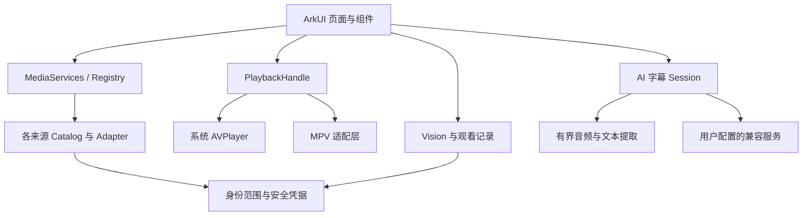

# 架构与代码入口

VablePlayer 将界面、来源协议、播放内核和字幕任务分开。新增服务时扩展来源边界，新增播放行为时通过小型播放接口对接，避免页面同时承担每家服务的鉴权细节。

## 文件地图

| 入口 | 职责 |
| --- | --- |
| [`Index.ets`](../entry/src/main/ets/pages/Index.ets) | 首页、来源管理、详情和主导航 |
| [`PlayerPage.ets`](../entry/src/main/ets/pages/PlayerPage.ets) | 播放页、控制层、切集和字幕任务的所有者 |
| [`components`](../entry/src/main/ets/components) | Dock、海报、Vision、来源浏览和独立设置等组件 |
| [`SourceProfiles.ets`](../entry/src/main/ets/common/SourceProfiles.ets) | 13 类来源的字段、认证方式、连接模式和能力模型 |
| [`services`](../entry/src/main/ets/common/services) | Registry、Catalog、Adapter、授权、文件与协议实现 |
| [`PlaybackHandle.ets`](../entry/src/main/ets/common/PlaybackHandle.ets) | 页面实际使用的播放接口；不冒充完整 AVPlayer API |
| [`MpvPlaybackHandle.ets`](../entry/src/main/ets/common/MpvPlaybackHandle.ets) / [`AvPlayerHandle.ets`](../entry/src/main/ets/common/AvPlayerHandle.ets) | MPV 与系统播放器的差异处理 |
| [`vision`](../entry/src/main/ets/common/vision) | 按来源及账号隔离的待看、在看、列表与导航 |
| [`ai`](../entry/src/main/ets/common/ai) | 加密配置、兼容服务请求、cue 校验、字幕任务和提取桥 |
| [`cpp`](../entry/src/main/cpp) | AI 提取、SMB 只读访问和授权本地 fd 模块 |
| [`tests`](../tests/README.md) | 提取实际源方法的契约测试、主机 helper 和包装层检查 |

## 来源协议

`MediaServices` 是页面的统一入口。`MediaServiceRegistry.forKind()` 分派 13 类直连适配器；`forServer()` 仅在用户明确选择且类型允许时，分派 WebDAV 聚合适配器。原类型与模式仍保留在身份配置中。

目录服务提供库、详情、分集、字幕与进度等能力。文件服务提供真实目录和可播放文件，不凭空生成影视元数据或远端收藏。实际字段、鉴权与限制见 [FEATURES](FEATURES.md)。飞牛兼容目录令牌和原生播放会话分别处理，Jellyfin/Emby/Plex 不借用飞牛协议。

`SourceIdentity` 参与账号范围计算；`Store` 与 `ServerCredentials` 管理普通状态及系统安全存储引用。来源、账号或代际改变后，旧登录、授权刷新、目录请求和播放任务不能回写新状态。

## 播放和资源所有权

`PlaybackHandle` 只抽象播放器页面实际需要的事件、状态和操作。MPV 与 AVPlayer 的来源赋值、首帧、比例、选轨及释放差异由具体适配层处理。请求头必须在正确的内核边界设置，不能用同一份未经验证的 URL 拼接替代服务端播放协商。

播放代际拥有内核实例、Range 代理、来源 lease、文件描述符、原生会话、字幕任务和小窗控制器。退出或切换先停止并释放旧资源，再进入新代际；迟到回调只允许清理自身资源。MPV 封装存在全局回调名称，禁止未经核对就创建第二个播放器做双实例预加载。

HTTP、SMB 与本地文件路径分别保持有界读、严格 Range 或只读 fd 的语义。失败应报告能力或连接错误，不转为无界缓存。缓存预算不是承诺所有设备的内存峰值，系统解码、分配器和 SDK 缓冲需要另外观察。

## AI 字幕

`AiSubtitleSession` 处理一次播放范围内的取消、seek、提取和翻译队列。外部/内封文本字幕可用时优先保留原时间轴；确无可用文本字幕时，受支持输入可以提取有界原声音频窗口并请求转写。

转写与翻译可以使用不同服务。`OpenAiSubtitleClient` 按用户配置调用兼容接口，并验证 cue ID、顺序和条数。没有真实时间戳时不得制造逐字同步；位图字幕不等于已实现 OCR。HLS 原声音频提取等限制见 [FEATURES](FEATURES.md)。

## 材质与动效

`Materials` 集中管理玻璃与系统沉浸材质，支持的弹层使用原生 Dialog/Menu/Popup/Sheet 容器。`MotionSpec`、`MotionFx` 与页面生命周期共同管理过渡；海报与背景回调需要校验来源和代际。不要在每次 `build` 中无条件新建材质，也不要为每个拖动 MOVE 排入新的动画。

## 验证层级

源方法/mock 检查验证业务契约，主机 C helper 检查边界算法，ArkTS/CMake/HAP 构建检查实际平台整合，真机检查才覆盖解码、触摸、材质和服务行为。各层结果不能互相替代。当前公开快照的执行结果见 [VALIDATION](VALIDATION.md)。
